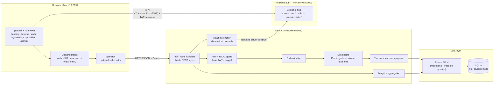

# SlotWise

**Bookings & analytics for small service businesses** — clinics, salons, tutors and physiotherapists.

SlotWise replaces the WhatsApp-roulette-and-paper-diary workflow with online booking, staff
schedules and a live performance dashboard. It is a full-stack web application built for the
Ravensbourne unit **CMS22204 — Full Stack Application Development** (Level 5, 40 credits).

> **Core guarantee:** double-bookings are impossible by design — the overlap check and the
> INSERT run inside a single serialized database transaction (see
> [Double-booking prevention](#double-booking-prevention)).

---

## Table of contents

1. [Feature overview](#feature-overview)
2. [Architecture](#architecture)
3. [Technology decisions (incl. why Prisma instead of Django ORM)](#technology-decisions)
4. [Getting started](#getting-started)
5. [Demo accounts](#demo-accounts)
6. [Data models](#data-models)
7. [API reference](#api-reference)
8. [Double-booking prevention](#double-booking-prevention)
9. [Security model](#security-model)
10. [Design decisions & trade-offs](#design-decisions--trade-offs)

---

## Feature overview

| Area | What it does |
| --- | --- |
| **Authentication** | Register / login, JWT **access + refresh** tokens (30 min / 30 d, rotation), bcrypt password hashing, single-flight silent refresh on the client |
| **Role-based access** | `ADMIN` / `PROVIDER` / `CUSTOMER` enforced by a server-side guard on **every** protected route; SPA view guards on the client |
| **Search** | Full-text across service name, category, description **and provider name**, debounced as-you-type |
| **Filtering** | Category chips, price brackets, provider, status, date range (`from`/`to`), upcoming-only |
| **Sorting** | Price ↑/↓, rating, **next available slot**, duration, popularity, name |
| **3-click booking** | Provider → slot grid → confirm. Slot grid is 15-min aligned, respects availability windows, lead time (60 min) and existing bookings; booked slots are greyed out |
| **Reschedule / cancel** | Customers reschedule or cancel their own pending/confirmed bookings with the same overlap guard |
| **Booking notes** | Customers attach a note per booking and edit it any time while pending/confirmed (inline popover editor); providers see the note in the diary |
| **Provider portal** | Day-by-day **diary navigator** (±60 d back / +30 d forward, “back to today”), one-click confirm / complete / no-show / cancel with server-enforced status transitions, weekly availability editor with overlap validation |
| **Admin dashboard** | KPIs (revenue, expected revenue, no-show rate, avg rating, active customers) with **previous-period trend deltas**, **cumulative revenue trend chart** (this period vs previous overlay), bookings-per-day area chart, revenue by service, **peak hours**, status mix donut, top providers, revenue by category — all live |
| **Admin bookings table** | **Server-side pagination** (`page`/`pageSize` up to 100, 937 bookings across 38 pages), compact page-window navigation, rows-per-page selector, live search/status/date filters that reset to page 1 |
| **CSV export** | Authenticated download of all bookings in a chosen range (RFC-4180 escaping) |
| **Provider profiles** | Public profile dialog: bio, specialty, weekly schedule grid, bookable services and recent reviews — one click from any provider chip |
| **Customer insights** | "My bookings" stats: next-visit countdown, upcoming count, completed visits, lifetime spend; landing page testimonials pulled live from verified reviews |
| **Customer favorites** | Heart any service from its card (rose toggle, optimistic + revert-on-error), then filter Browse with the **♥ Favorites (n)** chip — hearts persist per account and re-seed the cards on every load |
| **Reviews** | Customers rate completed bookings 1–5; ratings feed search ranking and provider stats. **Reviews can be edited or deleted within 15 minutes** of posting (server-enforced window) |
| **Responsive UI** | Mobile-first (tested at 375 / 768 / 1280 px), dark mode, sticky footer, toast feedback, skeleton loaders |
| **Realtime updates** | **Socket.io hub** (mini-service, port 3003): JWT-authenticated room subscriptions (`user:*`, `role:*`, `provider-slots:*`). Providers watch their diary update **live** (new booking / cancel / reschedule toasts, pulsing “Live” pill); the admin dashboard refreshes KPIs + charts in place with an activity ticker; an open booking dialog **greys out slots the instant someone else takes them** — and bounces the selection if the chosen slot was stolen. Privacy-safe by design: the public slot channel carries only timing data, never customer identity |
| **Live landing page** | Public activity ticker ("16 bookings in the last 24h") fed by `/api/activity`, auto-rotating and privacy-safe |
| **Provider time off** | Holidays, sick days and **partial-day blocks** (e.g. 12:00–14:00) under the Availability tab. Slots inside a window stop being bookable **server-side** (`409 PROVIDER_TIME_OFF`), the booking dialog shows an "Away on this day" banner, customers with affected bookings get a schedule-change notification, and open slot grids refresh live over the hub |
| **Calendar invites** | Every booking exports a standards-compliant **RFC 5545 `.ics`** file (VEVENT + 60-minute reminder VALARM) — "Add to calendar" on the booking success screen and on every upcoming card |
| **Notification inbox** | Mock email outbox: booking receipts, status changes, cancellations, reschedules, time-off conflicts **and waitlist alerts** persist as per-user notifications and **push live** to the header bell — unread badge + toast — with mark-all-read **and click-a-single-item-to-read** |
| **Slot waitlist** | Customers **watch a taken slot** (little bell on any greyed-out slot in the booking calendar, or the "Watch it" banner that appears the moment someone steals their chosen slot). When the holding booking is cancelled or rescheduled away, every watcher gets a one-shot **"slot opened"** notification (in-app + bell + live toast), and the entry flips to an "alerted" state in My bookings → Waitlist. Server-enforced: only genuinely taken slots are watchable, no duplicates, max 10 active watches, watchers who already hold a conflicting booking are skipped |
| **Waitlist deep-link** | One click from a "slot opened" notification (inline **Book it** action in the bell) or from an alerted waitlist card (**Book this slot** / **View calendar**) jumps straight into the booking dialog **pre-filled** — right provider, right day, straight at the time picker, with a violet "From your waitlist" chip; dates beyond the 14-day picker fall back to today with a heads-up toast |
| **Provider insights** | The provider portal's **Insights tab**: revenue / bookings / rating / **utilisation (booked vs open hours)** / repeat-client share / upcoming KPIs, an **8-week performance chart** (booking bars + cumulative revenue area), top-services revenue mix and outcome donut — the same visual language as the admin dashboard |
| **Admin closures overview** | The Staff tab lists **every provider's upcoming time off** in one card — window reason, "N bookings to move" clash badges — and admins can lift a closure with one click (slots reopen instantly, open booking grids refresh live) |
| **Admin closure creation** | The Staff tab's "Add closure" dialog blocks **any provider's** calendar — full-day, a date range or part of one day (15-min steps) — with affected-customer notifications surfaced on submit; provider selection sticks for repeat blocks |

---

## Architecture



**Mapping to the classic three tiers:**

| Brief requirement | SlotWise implementation |
| --- | --- |
| React front-end served by a Node server | Next.js 16 App Router: React 19 SPA on `/`, Node route handlers under `/api/*` (the Node.js/Express equivalent — same REST contract, same middleware pattern, one process) |
| State management | Zustand `auth` + `ui` stores (the Context-API role, with less boilerplate) |
| ORM + database | Prisma ORM + SQLite (see [Technology decisions](#technology-decisions)) |
| Advanced features | Auth/RBAC, search/filter/sort, dashboard/reporting, CSV export, double-booking prevention |

---

## Technology decisions

**PostgreSQL vs MongoDB** (LO2 comparison): appointment data is inherently relational
(users ↔ providers ↔ services ↔ bookings ↔ reviews) with integrity constraints (unique
provider-service links, no overlapping ranges, FK cascades) and aggregate-heavy reporting
(group-by-day, by-service, by-provider). A relational database is the right tool; a document
store would push join/consistency logic into application code. The sandbox provides SQLite,
which carries the same relational guarantees (ACID, FKs, serializable writes) at zero-ops cost;
the schema is portable to PostgreSQL unchanged for deployment.

**Why Prisma ORM instead of Django ORM** (the honest note): the brief lists both a *Node.js
server* and *Django ORM*. Django ORM is a Python library and cannot run inside a Node process —
the two requirements are technically incompatible as written. Options were (a) split into a
Node API + separate Django service (doubles deployment surface, adds network hop for every
query) or (b) keep one Node stack with a Node-native ORM. SlotWise takes **(b)** with
**Prisma**: typesafe schema-first models, migrations, and the transaction primitives needed for
the double-booking guarantee, all in the same language and process as the API layer. This keeps
the artefact simpler, faster and fully type-safe end-to-end. *(Confirm this reading with the
unit leader, Dr Sermet Mir, before submission — this is the documented fallback.)*

**Front end:** React 19 + Tailwind CSS 4 + shadcn/ui (New York) + Recharts, with Zustand for
auth/booking state. JWT pair persisted in `localStorage`, silent refresh with a single-flight
promise so concurrent 401s share one refresh round-trip.

---

## Getting started

**Prerequisites:** [Node.js ≥ 20](https://nodejs.org) or [Bun](https://bun.sh) ≥ 1.1.

```bash
# 1. install dependencies
bun install        # or: npm install

# 2. configure environment (already present in this sandbox)
#    .env
#    DATABASE_URL="file:./db/custom.db"
#    JWT_SECRET="<random hex>"
#    JWT_REFRESH_SECRET="<random hex>"
#    REALTIME_URL="http://localhost:3003"       # realtime hub address
#    REALTIME_INTERNAL_KEY="<shared secret>"    # must match mini-services/realtime/.env

# 3. create the database schema
bun run db:push    # prisma db push

# 4. seed demo data (13 users, 11 services, ~520 bookings, ~180 reviews)
bun run db:seed

# 5. start the realtime hub (live diary / live slots / live dashboard)
cd mini-services/realtime && bun install && bun run dev   # port 3003

# 6. start the dev server
bun run dev        # http://localhost:3000
```

Other scripts: `bun run lint` (ESLint), `bun run db:generate`, `bun run db:migrate`,
`bun run db:reset`.

---

## Demo accounts

All demo accounts share the password **`Password#123`**.

| Role | Email | What to try |
| --- | --- | --- |
| Admin (owner) | `admin@slotwise.test` | Dashboard → charts, CSV export, Services CRUD, Staff, Bookings |
| Provider | `priya@slotwise.test` | Today's diary, confirm/complete, availability editor, **Insights tab** |
| Provider | `marco@slotwise.test` | Salon diary (Thu–Sat) |
| Customer | `sam@slotwise.test` | Search → 3-click book → reschedule/cancel/review |

Public registration always creates a `CUSTOMER`; staff accounts are provisioned by the admin —
self-service role escalation is impossible.

---

## Data models

```
User        id, name, email (unique), passwordHash, role[ADMIN|PROVIDER|CUSTOMER], timestamps
Provider    id, userId → User (1:1), bio, specialty, isActive
Service     id, name, category, description, durationMin, price, isActive, timestamps
ProviderService  (providerId, serviceId) composite PK — M:N link
Availability     id, providerId → Provider, weekday (0=Sun…6=Sat), startMin, endMin
                 unique (providerId, weekday, startMin)
TimeOff     id, providerId → Provider, startAt, endAt, reason — holidays/sick days/partial-day
             blocks; slots overlapping a window are unbookable (index: providerId, startAt)
Booking     id, customerId → User, providerId → Provider, serviceId → Service,
            startAt, endAt, status[PENDING|CONFIRMED|COMPLETED|CANCELLED|NO_SHOW],
            notes, timestamps
            index (providerId, startAt) — the double-booking scan path
Review      id, bookingId → Booking (1:1, unique), authorId → User, rating (1–5), comment
Notification id, userId → User, type[booking_created|booking_status|booking_cancelled|
            booking_rescheduled|time_off_conflict|waitlist_opened], title, body, bookingId → Booking?,
            meta? (JSON — powers inline actions such as the waitlist deep-link),
            readAt? — mock email outbox (index: userId, createdAt)
Waitlist    id, userId → User, providerId → Provider, serviceId → Service, startAt, endAt,
            notifiedAt? — "alert me when this taken slot frees up" entries
            unique (userId, providerId, startAt); index (providerId, startAt)
Favorite    id, userId → User, serviceId → Service, createdAt — hearted services for the
            Browse ♥ favorites filter; unique (userId, serviceId)
```

Prisma schema: [`prisma/schema.prisma`](prisma/schema.prisma) · Seed: [`prisma/seed.ts`](prisma/seed.ts)

*(Roles and statuses are strings validated by Zod rather than Prisma enums, because Prisma does
not support enums on SQLite.)*

---

## API reference

All endpoints are JSON over HTTPS, authenticated via `Authorization: Bearer <accessToken>`.
Errors return `{ "error": string, "code": string }`. Base URL: `/api`.

### Auth

| Method | Path | Access | Body / Query |
| --- | --- | --- | --- |
| POST | `/auth/register` | public | `{ name, email, password }` → tokens + user (role fixed to CUSTOMER) |
| POST | `/auth/login` | public | `{ email, password }` → tokens + user |
| POST | `/auth/refresh` | public | `{ refreshToken }` → rotated token pair |
| POST | `/auth/logout` | public | stateless — client discards tokens |
| GET | `/auth/me` | any | → current user profile |

### Services

| Method | Path | Access | Notes |
| --- | --- | --- | --- |
| GET | `/services` | public | `q, category, minPrice, maxPrice, provider, sort` (`price_asc\|price_desc\|rating\|next_available\|duration\|popular\|name`), `includeInactive=1` (admin); rows carry `isFavorite` when a customer is signed in |
| POST | `/services` | admin | `{ name, category, description?, durationMin, price, isActive?, providerIds? }` |
| PUT | `/services/:id` | admin | partial update + provider re-link |
| DELETE | `/services/:id` | admin | soft-deletes (deactivates) when booking history exists |

### Providers & slots

| Method | Path | Access | Notes |
| --- | --- | --- | --- |
| GET | `/providers` | public | `q`, `all=1` (admin) |
| POST | `/providers` | admin | provisions a PROVIDER user (name, email, password, bio, specialty, serviceIds) |
| GET | `/providers/:id` | public | full profile: services, rating, weekly availability + 10 recent reviews (email admin-only) |
| PATCH | `/providers/:id` | admin | bio / specialty / isActive / service links |
| GET | `/providers/:id/slots` | public | `date=YYYY-MM-DD&serviceId` → slot grid with `available` flags + `blockedBy` reason (`booking\|lead\|timeoff`) + overlapping `timeOff` windows |
| GET | `/providers/me/availability` | provider/admin | weekly windows |
| PUT | `/providers/me/availability` | provider/admin | full replace; rejects overlapping windows |
| GET | `/providers/me/analytics` | provider | Insights tab: KPIs (revenue 30d, bookings 30d, rating, **utilisation %**, repeat-client %, upcoming) + 8-week `weekly` series + `serviceMix` + `statusMix` |
| GET | `/providers/me/time-off` | provider/admin | upcoming + recent windows, each with a live count of affected bookings |
| POST | `/providers/me/time-off` | provider/admin | `{ date, endDate?, startTime?, endTime?, reason? }` — full-day or partial block; affected customers get a schedule-change notification; `201` returns the window + `notified` count. Admins may pass `?providerId=` to block **any** provider's calendar (same contract) |
| DELETE | `/providers/me/time-off/:id` | provider/admin | removes the block (slot grids refresh live); admins may pass `?providerId=` to lift any staff member's closure |

### Bookings

| Method | Path | Access | Notes |
| --- | --- | --- | --- |
| GET | `/bookings` | any (role-scoped) | customers→own, providers→own diary, admin→all; `status, from, to, q, upcoming, sort`. Optional `page`+`pageSize` → paginated `{items,total,page,pageSize,pageCount}` (server clamps out-of-range pages); omitted → legacy `{items,total}` |
| POST | `/bookings` | customer | `{ serviceId, providerId, startAt, notes? }` — transactional overlap guard → `409 SLOT_TAKEN`; invalid input → `422 VALIDATION_FAILED` |
| PATCH | `/bookings/:id` | customer (own) | two modes: `{ startAt }` reschedule (same guard, excludes itself) or `{ notes }` — edit/clear the note (PENDING/CONFIRMED only) |
| DELETE | `/bookings/:id` | owner/provider/admin | cancel (PENDING/CONFIRMED only) |
| PATCH | `/bookings/:id/status` | provider (own) / admin | enforced transitions: PENDING→CONFIRMED\|CANCELLED, CONFIRMED→COMPLETED\|NO_SHOW\|CANCELLED |
| POST | `/bookings/:id/review` | customer (own) | COMPLETED only, once; `{ rating 1-5, comment? }` |
| GET | `/bookings/:id/calendar.ics` | owner/provider/admin | RFC 5545 calendar invite (VCALENDAR/VEVENT + 60-min VALARM); cancelled bookings → 400 |

### Notifications (mock email outbox)

| Method | Path | Access | Notes |
| --- | --- | --- | --- |
| GET | `/notifications` | any | own inbox — `limit` → `{ items, unread }`; rows are created on booking create/cancel/reschedule/status-change/time-off conflicts **and waitlist alerts**, and pushed live over the realtime hub; `waitlist_opened` rows carry a `meta` JSON payload (`serviceId`, `providerId`, `startAt`, `endAt`) that powers the bell's inline **Book it** deep-link |
| POST | `/notifications/read-all` | any | marks the whole inbox read |
| POST | `/notifications/:id/read` | any (own) | marks a **single** notification read (idempotent) |

### Waitlist ("alert me when a slot frees")

| Method | Path | Access | Notes |
| --- | --- | --- | --- |
| GET | `/waitlist` | any (own) | the signed-in customer's watched slots, `notifiedAt` included for history |
| POST | `/waitlist` | customer | `{ providerId, serviceId, startAt, endAt }` — the slot must genuinely be held by a booking (`409 NOT_TAKEN`), no duplicates (`409 ALREADY_WATCHING`), no self-overlap (`400 ALREADY_BOOKED`), max 10 active watches. When the holding booking is cancelled or rescheduled away, each eligible watcher gets a one-shot `waitlist_opened` notification and the entry flips to notified |
| DELETE | `/waitlist/:id` | any (own) | stop watching |

### Favorites

| Method | Path | Access | Notes |
| --- | --- | --- | --- |
| GET | `/favorites` | customer | own hearted serviceIds (creation order) |
| POST | `/favorites` | customer | `{ serviceId }` — toggle-safe: fresh heart `201 {alreadyFavorite:false}`, repeat `200 {alreadyFavorite:true}`; `400 UNKNOWN_SERVICE` / `400 INACTIVE_SERVICE` guards |
| DELETE | `/favorites/:serviceId` | customer | removes the heart (`404 NOT_FOUND` when absent) |

### Dashboard & misc

| Method | Path | Access | Notes |
| --- | --- | --- | --- |
| GET | `/dashboard/summary` | admin | `range=7\|30\|90` → KPIs (incl. previous-period deltas) + all chart series incl. `revenueTrend` (cumulative this-period vs previous) |
| GET | `/dashboard/export` | admin | `range` → CSV download |
| GET | `/admin/time-off` | admin | every provider's upcoming closures with clash counts (Staff tab overview) |
| GET | `/categories` | public | distinct categories + counts |
| GET | `/reviews/recent` | public | `limit` → latest written reviews (testimonials) |
| GET | `/activity` | public | `limit` → privacy-safe recent-booking feed + 24h count (landing ticker) |
| PUT | `/reviews/:id` | author | edit own review within **15 min** of posting; `{ rating, comment? }` |
| DELETE | `/reviews/:id` | author | delete own review within 15 min (booking becomes reviewable again) |
| GET | `/health` | public | liveness probe |
| GET | `/api` | public | machine-readable endpoint index |

---

## Double-booking prevention

The standout technical feature. Bookings are stored as `[startAt, endAt)` ranges per provider.
Creating (or rescheduling) a booking runs **one interactive Prisma transaction**:

```ts
await db.$transaction(async (tx) => {
  // …validate service/provider/availability/lead time…
  const busy = await tx.booking.findMany({
    where: {
      providerId,
      status: { in: ["PENDING", "CONFIRMED"] },
      startAt: { lt: dayEnd }, endAt: { gt: dayStart },
    },
  });
  if (busy.some((b) => b.startAt < endAt && b.endAt > startAt)) {
    throw new HttpError(409, "SLOT_TAKEN", "This slot has just been booked.");
  }
  return tx.booking.create({ /* … */ });
});
```

The overlap check (`a.start < b.end && a.end > b.start`) and the INSERT execute atomically, and
SQLite serialises writers (single-writer lock), so two concurrent requests can never both pass
the check — the second writer receives `409 SLOT_TAKEN`. This is the SQLite-portable equivalent
of a PostgreSQL `EXCLUDE` constraint on a `tstzrange` overlap, which would be the
production-grade expression on Postgres.

Additional invariants enforced server-side: the slot must fit **entirely inside one weekly
availability window**, must not overlap any **time-off window** (`409 PROVIDER_TIME_OFF`),
respect a 60-minute lead time, and the provider must actually be linked
to the service.

---

## Security model

- **Passwords**: bcrypt (cost 10); hashes only, never returned by any endpoint.
- **JWT**: HS256 via `jose`; 30-minute access tokens + 30-day refresh tokens with **rotation**
  on every refresh; separate secrets; type-claim prevents token-kind confusion.
- **RBAC**: `requireSession(req, roles)` guard on every protected route; role always re-read
  from the database (revoking a role takes effect immediately, not at token expiry).
- **Input validation**: Zod schemas on every mutating endpoint; schema failures return
  `422 VALIDATION_FAILED` with a readable field message (never a 500).
- **Authorization**: booking ownership checks (customer can only touch *own* bookings;
  provider only *own* diary rows); public registration can't grant roles.
- **SQL injection**: impossible by construction (Prisma parameterised queries).

---

## Design decisions & trade-offs

- **Single-page app on `/`** with client-side view switching — the sandbox exposes one route;
  a hash/router-based split adds no value here and the store-driven navigation keeps deep
  intents (e.g. "sign in to book") resumable.
- **Business timezone = UTC** (all times rendered as UTC wall-clock). A production build would
  store per-business timezones with `timestamptz`; the simplification removes DST ambiguity in
  the demo without affecting the booking logic.
- **Search filtering** partly in SQL (category, price, text) and partly in JS (provider-name
  match, next-available sort) — at demo scale (≤ hundreds of rows) this keeps one query shape
  for all filters; at production scale the provider-name search would move to a join/FTS.
- **Soft delete for services** with booking history so analytics stay historically accurate.
- **Status transitions are a server-side state machine** — the UI offers only legal actions,
  but the API enforces the same rules regardless of client.
